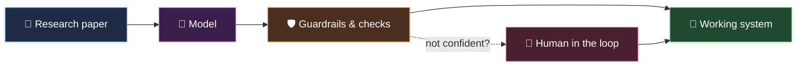

<div align="center">


<a href="https://github.com/smanika3">
  
</a>

</div>

<br>

```python
class Sai:
    school    = "Arizona State University · M.S. CS '27"
    obsessed  = ["deep learning", "computer vision", "LLM systems", "accessibility"]
    method    = "paper ➜ prototype ➜ guardrails ➜ shipped"
    fuel      = "hard problems + a deadline"
    status    = "open to ML/AI roles 🟢"
```

<br>

## ⚡ My whole philosophy, in one diff

```diff
- a model that only works in the notebook
+ a system that holds up outside the lab

- an LLM answer you just have to trust
+ an answer that traces back to the exact source row

- "the AI said so"
+ "the AI is sure, here's why. If it isn't, a human decides."
```

<br>

## 🧬 How I build things



<br>

## 🗂️ What I've built

```bash
$ ls ~/built

slidesight/       # writes alt text for lecture slides, humans handle the unsure ones
fundsentinel/     # 14 AI agents that audit mutual funds (and each other)
swin-cxr-suite/   # chest X-ray models built on Swin Transformers
zesto/            # iOS app that turns grocery receipts into recipe ideas
```

<br>

## 🧭 Start here

> [!TIP]
> Short on time? Pick one. They're ordered by how fast you'll "get" them.

<table>
  <tr>
    <td width="33%" valign="top" align="center">
      <h3>♿ SlideSight</h3>
      <sub><b>⭐ START HERE</b></sub>
      <p>Alt text for lecture slides, with a human stepping in when the AI isn't sure.</p>
      <a href="https://github.com/smanika3/ASU-AIR-SlideSight"><b>Open repo →</b></a>
    </td>
    <td width="33%" valign="top" align="center">
      <h3>🕵️ FundSentinel</h3>
      <sub><b>🎭 THE FUN ONE</b></sub>
      <p>A committee of AI agents that checks each other's math before approving a fund.</p>
      <a href="https://github.com/smanika3/FundSentinel"><b>Open repo →</b></a>
    </td>
    <td width="33%" valign="top" align="center">
      <h3>🩻 Swin-CXR-Suite</h3>
      <sub><b>🔬 FOR THE RESEARCH NERDS</b></sub>
      <p>Swin Transformers reading chest X-rays, three different ways.</p>
      <a href="https://github.com/smanika3/Swin-CXR-Suite"><b>Open repo →</b></a>
    </td>
  </tr>
</table>

<br>

<div align="center">

```text
┌──────────────────────────────────────────────┐
│                                              │
│   $ echo "thanks for stopping by 👋"         │
│   > thanks for stopping by 👋                │
│                                              │
│   $ ./say_hi --if-something-caught-your-eye  │
│                                              │
└──────────────────────────────────────────────┘
```

[](https://smanika3.github.io/)
[](https://www.linkedin.com/in/smanika3/)
[](mailto:saisrivathsan2004@gmail.com)


</div>
